# Hồ sơ nghiệm thu: Dữ liệu Google Sheets theo hợp đồng, đổi số phiếu, phân bổ phiếu cân

Nhánh: `wave-e/nghiem-thu` (nền: `df0c2ba`). Phạm vi so với nền `baa866e`. Ngày lập: 22/11/2026. Người lập: agent `hak-release-verifier` (hồ sơ do Queen kiểm, CHỦ duyệt).
Mọi dữ liệu trong hồ sơ này là **giả lập** (CCCD dãy `0490000000xx`, tên có chữ "giả lập"). Số liệu ở mục 2 do Queen chạy; mục 3, 4 do người lập chạy trong phiên này; chỗ nào chưa kiểm được thì ghi rõ "chưa kiểm".

## 0. Cập nhật ngày 23/11/2026 (bản cuối `7305237`, theo quyết định của CHỦ)

Quyết định của CHỦ ngày 23/11/2026, đã cài:
1. **QĐ7 nghĩa đen:** "Cập nhật vào hồ sơ" ghi TOÀN BỘ (chủ rừng, lô, rừng, tọa độ, giấy tờ, ánh xạ biển số, phiếu cân) vào **bản nháp**; chỉ lưu khi bấm "Lưu dữ liệu vào lô". Cơ chế nháp qua một cửa ghi duy nhất `dbGhi` (`ui/app/02-luu-tru-trang-thai.js`: `loMoi`, `chuNhap`, `aliasNhap`); khôi phục bản nháp sau mở lại ứng dụng; "Lưu và đóng" lưu mọi lô nháp, lô nào lỗi thì không đóng và không xóa bản tạm.
2. **QĐ6:** giữ nguyên, "Đối chiếu với Google Sheets" chạy khi bấm nút.
3. **Thêm xe:** hộp xác nhận liệt kê biển số chưa có trong danh sách xe của lô kèm ô "Thêm xe vào lô" mặc định tích; bỏ tích thì "Lưu dữ liệu vào lô" bị chặn như cũ.

Số liệu thật sau các thay đổi trên (Queen tự chạy):

| Hạng mục | Kết quả |
|---|---|
| Unit (`node scripts/test.js`) | **791/793** đạt, 2 bỏ qua, 0 lỗi |
| So bản in 206 `.docx` so với v3.2.0 (cùng ngày dựng, vì `00_Muc_luc.docx` có ngày) | **206/206 giống từng byte** |
| `npm audit --omit=dev` | **0 lỗ hổng** |
| e2e toàn bộ (1024×768), 132 bộ gồm `e2e-sheets-nhap-nhap` | **132/132 bộ đạt**, 2567 kiểm tra đạt, 0 lỗi, 1 phần bỏ qua (thiếu mã nguồn v1.4.33), 1626 s |
| CI Windows | xem kết quả trên PR |

Soát độc lập thay đổi QĐ7 (hai vòng, chỉ đọc): vòng 1 tìm 4 lỗi P1 (Lưu và đóng mất nháp lô khác; khôi phục bỏ lô mới của chủ rừng đã có; bản trình duyệt không chốt `savedSnap`; xóa lô/rừng không dọn sổ nháp) và các P2; **đã sửa hết**. Vòng 2: **0 P0/P1**; P2/P3 mới (khôi phục sổ ghi đè mục mới; ánh xạ biển số `lkApply`; điều hướng khi lưu hàng loạt lỗi; hạn "Lưu và đóng"; nuốt lỗi chụp `savedSnap`; thông báo) đã sửa ở `7305237`.

**Điểm chưa có test tái hiện chạy ra đỏ trước khi sửa** (chỉ kiểm bằng đọc mã và các e2e hiện có): nhánh `localStorage` (không có tiến trình chính; e2e chạy Electron nên không phủ), race giữa lần lưu hẹn giờ và lưu tay, ánh xạ biển số của `lkApply` (P2-2), `delRs`. Các bộ e2e liên quan (nháp, lưu, sao lưu, chốt, đối chiếu) đều xanh.

Hạn chế đã biết thêm: xe không có trong danh mục chỉ có biển số, lưu lô vẫn có thể bị chặn vì thiếu chủ xe/người ký (khai ở tab Vận chuyển); thông tin chủ rừng nháp được chốt cùng lần lưu lô đầu tiên của chủ rừng (kể cả phần đến từ lô khác); hợp đồng chỉ đổi thông tin chủ rừng mà chủ rừng chưa có lô nào bị từ chối kèm thông báo; ánh xạ biển số dùng chung nhiều lô chỉ lên đĩa khi lưu hết các lô liên quan. Số phiên bản đề xuất **3.3.0** (không có migration SQLite).

## 1. Danh sách cam kết (`git log baa866e..df0c2ba --oneline`, 18 cam kết, mới nhất ở trên)

```
df0c2ba Hoàn thiện 3 bộ e2e Dữ liệu Google Sheets: lưu bản nháp, đổi số, Mở/Đối chiếu, khung hẹp, chuỗi độc hại
e8800fc Sửa e2e cũ theo quyết định của CHỦ: màn đầu là bảng hợp đồng, QĐ5, đổi tên màn, thêm nút Đổi số
d7f3156 Merge branch 'claude/magical-dijkstra-xhn2k9' into wave-b/e2e
0b548cf Thêm 3 bộ e2e Dữ liệu Google Sheets (hợp đồng, đổi số, chủ rừng đối chiếu) và đăng ký trong e2e-all
0bfe6a6 feat(ui): bảng hợp đồng Sheets tính trạng thái bằng lookup:summaryHd (ưu tiên dòng đang hiện, lô 200); tạo lô từ lô cũ có taoLuc
b1d09ba Merge branch 'wave-d/fix-src' into wave-d/fix-ui
a03dd5d fix(ui): hộp thoại hợp đồng Sheets — hoàn tác stage khi lỗi, chặn đóng khi ghi, thứ tự rừng QĐ8, che CCCD, tối ưu vòng lặp, nhãn QĐ7
ed3d985 perf(lookup): chỉ mục mã hợp đồng, bỏ ORDER BY khiến quét cả bản; thêm summaryHd; che CCCD trong cảnh báo; chặn limit
add19cc merge: màn Dữ liệu Google Sheets (hak-ui-sheets); nối window.moDuLieuSheets cho màn chủ rừng; dựng lại renderer
df8c4cf fix(ui): khung hẹp ≤ 820 px — Cha xếp trên Con, không đè lên nhau
2c69998 fix(ui): hợp đồng nhiều rừng — _id bản nháp chỉ duy nhất theo lô, bảng phiếu gọn
bec8048 Merge branch 'claude/magical-dijkstra-xhn2k9' into wave-a/ui-chu
d6fa7b1 feat(ui): màn Dữ liệu Google Sheets — bảng toàn bộ hợp đồng và hộp thoại Cha–Con theo mã hợp đồng
c13f67b feat(ui): đổi số phiếu cân riêng, nối soLog, Mở/Đối chiếu Google Sheets ở màn chủ rừng và hồ sơ rừng
6602ed4 test(luu-tru): round-trip, delta/băm, lô chốt và chặn Đổi số cho soCu/soLog/info.nguon
874c0ff build: nhúng src/doiso.js và src/phanbophieu.js vào bản dựng giao diện
17e4ee8 feat(data): tra cứu theo mã hợp đồng, phân bổ phiếu cân vào rừng, phát hiện và xử lý đổi số phiếu (lớp dữ liệu, chưa nối giao diện)
b57c02f docs: đặc tả và thiết kế dữ liệu cho Dữ liệu Google Sheets theo hợp đồng, đổi số phiếu, phân bổ phiếu cân (G1)
```

Chưa có PR (chưa mở). Phạm vi mã: `src/doiso.js`, `src/phanbophieu.js` (mới), `src/lookup.js`, `src/stage.js` (sửa), `ui/` và `renderer/index.html` (dựng lại), 3 bộ e2e mới. **`src/store.js` không đổi so với v3.2.0** (không có migration SQLite mới, `user_version` vẫn 15).

## 2. Kết quả kiểm thử (số thật Queen đã chạy)

| Hạng mục | Kết quả |
|---|---|
| Unit (`node scripts/test.js`) | **791/793** đạt, 2 bỏ qua, 0 lỗi |
| So bản in (206 tài liệu `.docx`) | **206/206 giống từng byte** so với v3.2.0 |
| `npm audit --omit=dev` | **0 lỗ hổng** |
| e2e toàn bộ (1024x768) | **131/131 bộ đạt**, 2536 kiểm tra đạt, 0 lỗi, 1 phần bỏ qua (thiếu mã nguồn v1.4.33), 1690 s |
| e2e trước khi sửa test cũ | 119/128. 9 bộ đỏ đều do **quyết định của CHỦ** đổi giao diện: màn đầu thành bảng hợp đồng, QĐ5, đổi tên màn, nút Đổi số. Chi tiết: `scratchpad/e2e-run3/summary.md` của Queen. Các test cũ được sửa theo quyết định (cam kết `e8800fc`), không sửa để "cho xanh" |
| Soát mã | 0 P0; 2 P1 và 5 P2 đã sửa ở đợt D (`ed3d985`, `a03dd5d`); P3 còn lại ở mục 5 |
| Soát an ninh | 0 mức Cao |
| CI Windows (`build-windows.yml`) | **CHƯA CHẠY** (chưa có PR, chưa gắn thẻ). Không có liên kết lượt chạy. Điều kiện bắt buộc trước khi gộp |
| Kiểm tra trên Windows thật, màn hình scaling 150 % | **CHƯA KIỂM** |

Ba bộ e2e mới của tính năng: `scripts/e2e-sheets-hop-dong.js`, `scripts/e2e-sheets-doi-so.js`, `scripts/e2e-chu-rung-doi-chieu.js` (nằm trong 131 bộ).

## 3. Ảnh chụp màn (Electron thật, dữ liệu giả lập, deviceScaleFactor 2, PNG nén bảng màu 128, 79–207 KB/ảnh)

Chụp bằng kịch bản dùng lại đúng dữ liệu của các bộ e2e. Hai độ rộng cửa sổ: 1024x768 và 1366x768. Không có lỗi JavaScript trong cả 6 lượt chụp. Mỗi ảnh đã được xem trực tiếp; nhận xét kèm theo là thật.

### 3.1 Bảng hợp đồng (mặc định "Theo hợp đồng"; 9 hợp đồng, tab Trạng thái Đủ 6 / Cần xem 2 / Lỗi dữ liệu 1)
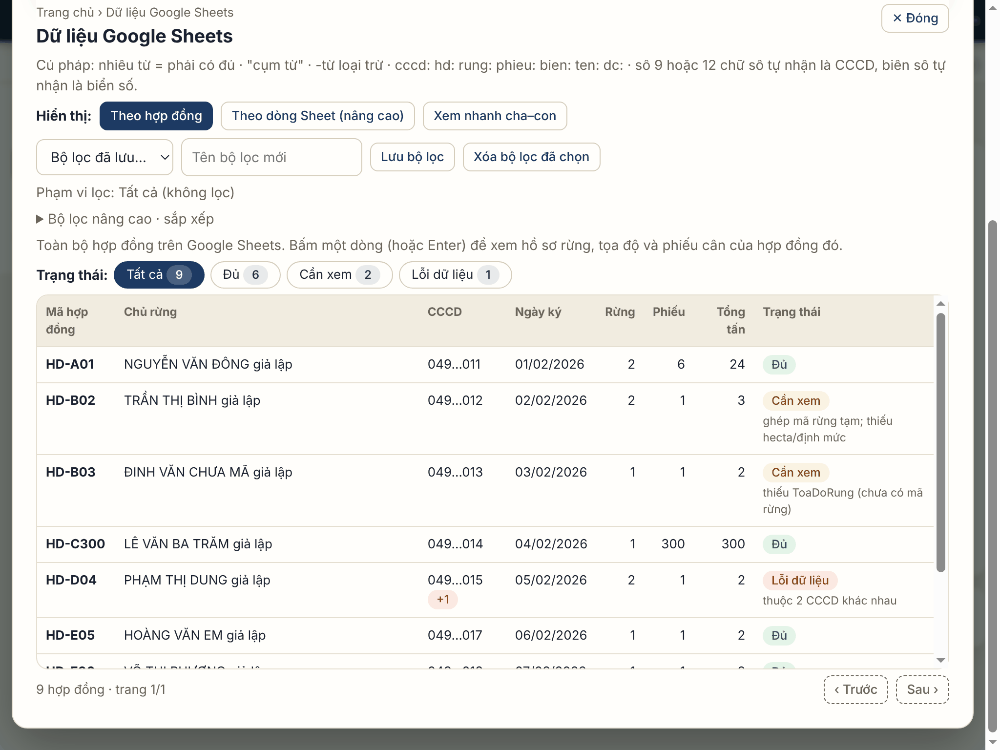 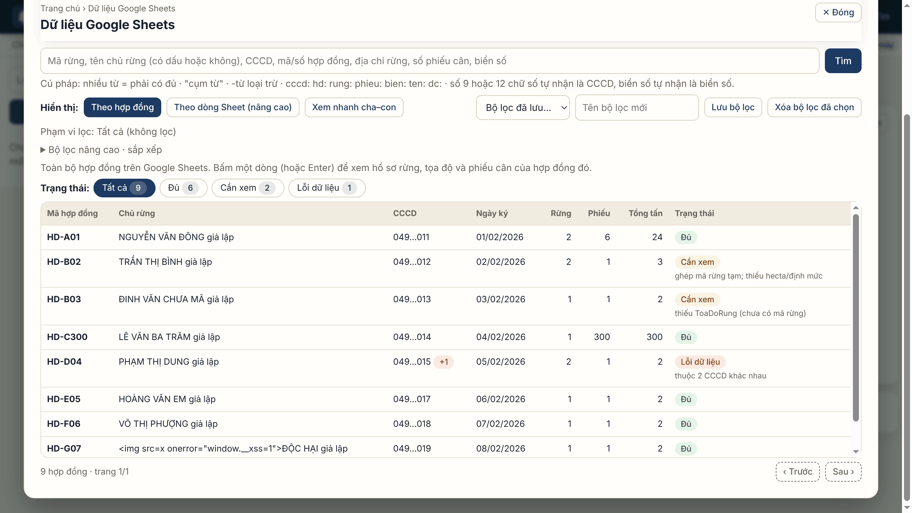
Nhận xét: cột Mã hợp đồng, Chủ rừng, CCCD che giữa (`049…011`), Ngày ký, Rừng, Phiếu, Tổng tấn, Trạng thái; lý do "Cần xem" hiện ngay dưới nhãn; hợp đồng nhiều CCCD hiện nhãn `+1` và "Lỗi dữ liệu". Ở 1024x768 phần đầu màn (thẻ Bản tra cứu, ô tìm, bộ lọc đã lưu) chiếm gần hết chiều cao; **không cuộn thì chỉ thấy 2 dòng hợp đồng** (ảnh chụp sau khi cuộn xuống bảng). Không lỗi vỡ bố cục. Ghi nhận là điểm dùng khó ở 1024x768 (không phải lỗi).

### 3.2 Hộp thoại Cha–Con, hợp đồng 2 rừng (HD-A01, thẻ Phiếu cân, phân bổ tự động 6 phiếu)
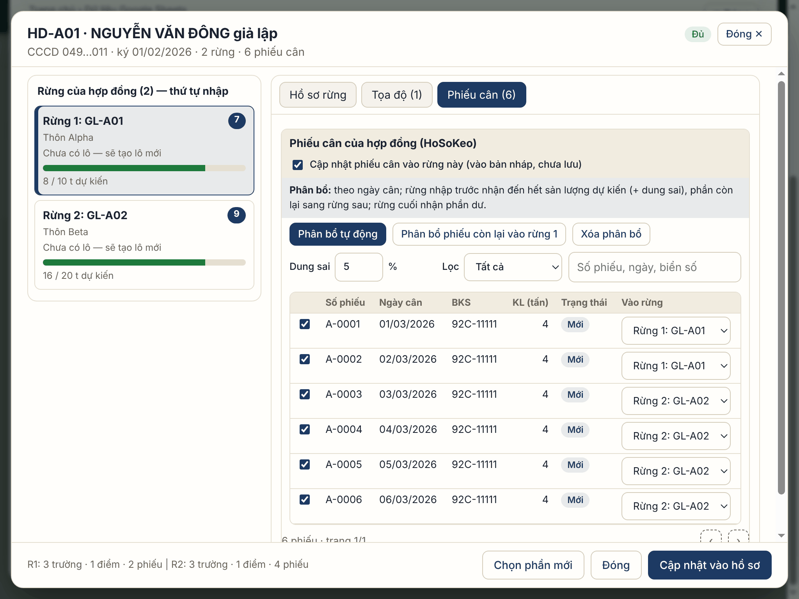 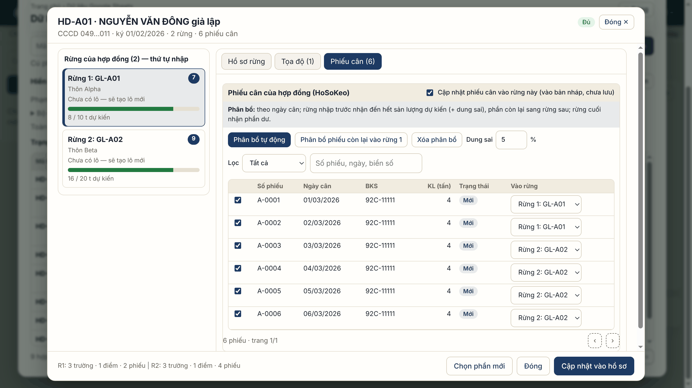
Nhận xét: Cha (trái) liệt kê Rừng 1 GL-A01 (8/10 t) và Rừng 2 GL-A02 (16/20 t) có thanh đã dùng; Con (phải) 3 thẻ Hồ sơ rừng / Tọa độ / Phiếu cân; mỗi phiếu có ô chọn rừng. Chân modal cố định, ba nút nằm trong khung nhìn. Lỗi nhỏ thấy được: ở 1024 dòng "6 phiếu · trang 1/1" và nút phân trang `‹ ›` bị chân modal cắt ngang một phần (phải cuộn trong khung nội dung); hai nút `‹ ›` ở mép phải hơi lấn ra ngoài thẻ trắng (cả 1024 và 1366). Không ảnh hưởng thao tác.

### 3.3 Phân bổ vượt dự kiến (dồn cả 6 phiếu vào Rừng 1: 24 t so với dự kiến 10 t)
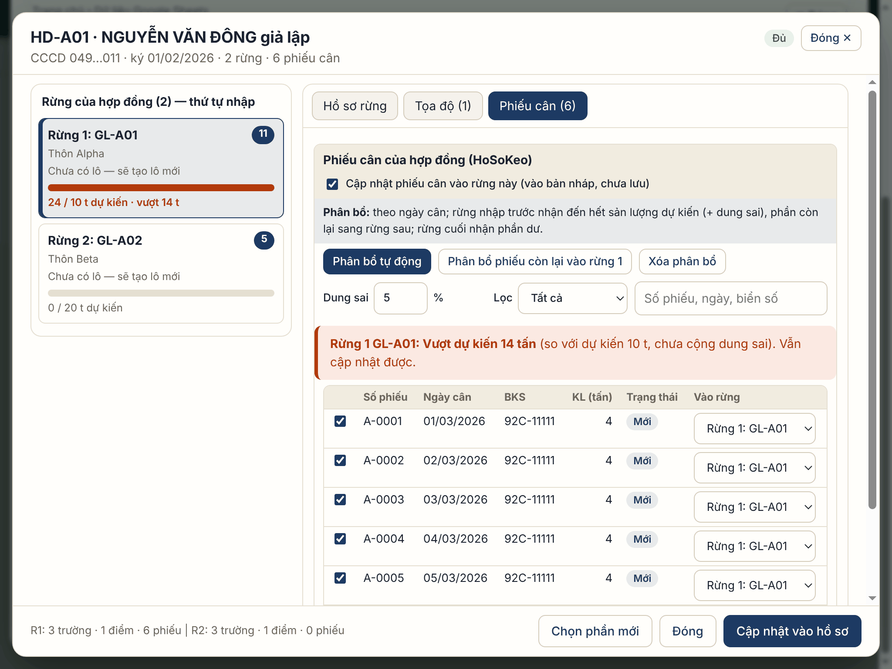 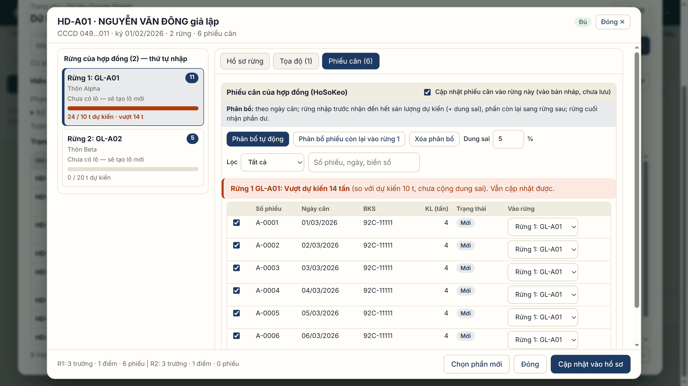
Nhận xét: thanh Rừng 1 đổi màu cam-đỏ "24 / 10 t dự kiến · vượt 14 t"; khung đỏ "Vượt dự kiến 14 tấn (so với dự kiến 10 t, chưa cộng dung sai). Vẫn cập nhật được." (QĐ2). Hiển thị đúng, rõ.

### 3.4 Xác nhận 2 bước (HD-D04, một mã hợp đồng thuộc 2 CCCD; ảnh ở bước 2/2)
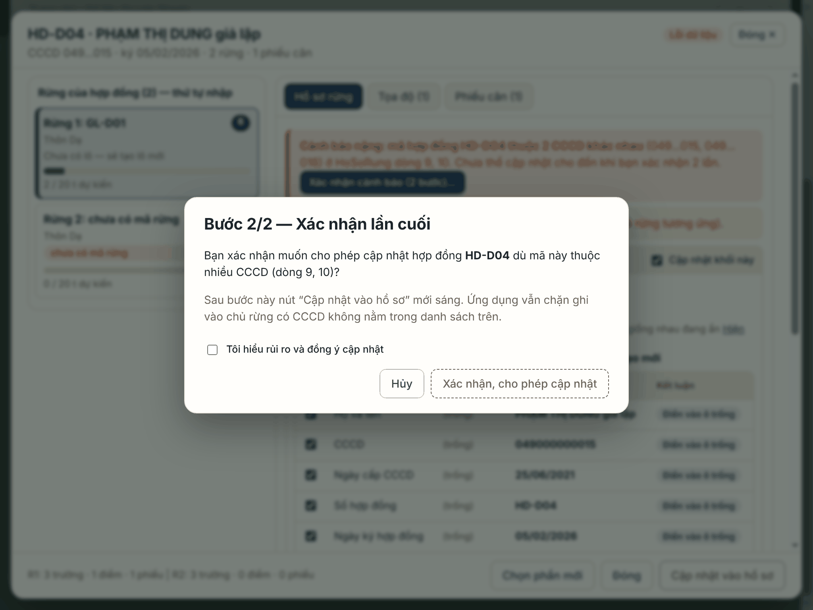 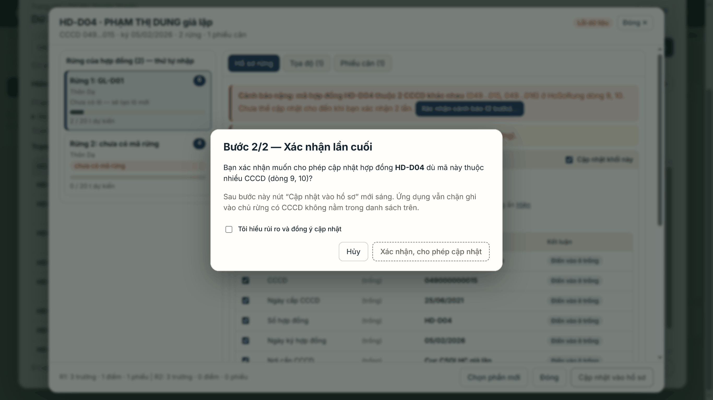
Nhận xét: hộp "Bước 2/2 — Xác nhận lần cuối", nêu mã HD-D04 và dòng 9, 10; ô tích "Tôi hiểu rủi ro và đồng ý cập nhật"; nút xác nhận nét đứt (đang khóa) cho đến khi tích. Nền modal bị làm mờ mạnh nên chữ nền không đọc được (chủ ý). Đúng bố cục.

### 3.5 Nghi đổi số (Sheet có `S-1001B`, hồ sơ có `S-1001`: cùng ngày, BKS, khối lượng)
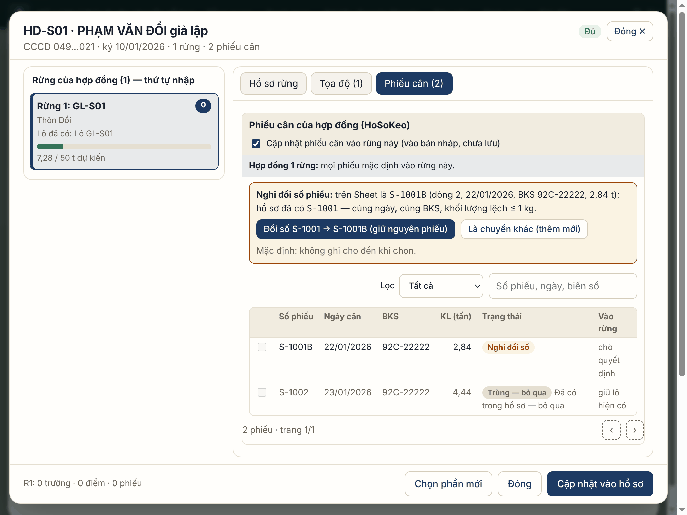 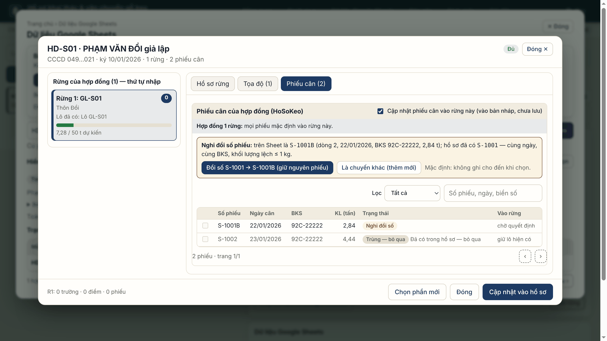
Nhận xét: khung cam "Nghi đổi số phiếu" nêu cặp số cũ/mới, dòng Sheet, BKS, 2,84 t; hai nút "Đổi số S-1001 → S-1001B (giữ nguyên phiếu)" và "Là chuyến khác (thêm mới)"; "Mặc định: không ghi cho đến khi chọn"; ô tích phiếu nghi đổi số bị khóa. Lỗi hiển thị nhỏ ở 1024: cột "Vào rừng" hẹp nên chữ "chờ quyết định" và "Đã có trong hồ sơ — bỏ qua" bị xuống dòng nhiều (3 dòng); ở 1366 gọn một dòng.

### 3.6 Màn chủ rừng: khung "Dữ liệu Google Sheets" (hai nút Mở / Đối chiếu)
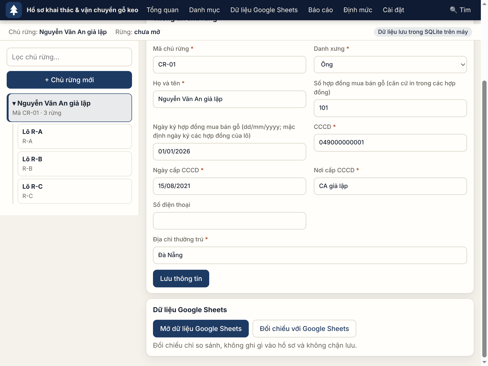 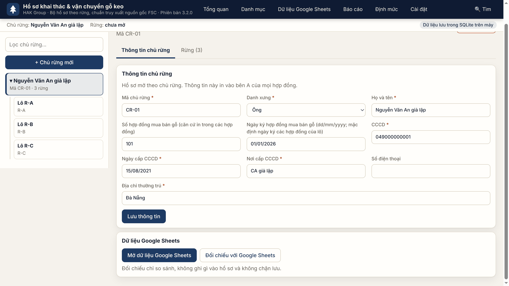
Nhận xét: khung dưới form Thông tin chủ rừng, có ghi chú "Đối chiếu chỉ so sánh, không ghi gì vào hồ sơ và không chặn lưu". Hiển thị đúng. Thanh điều hướng cố định che mép trên khi cuộn (hành vi bình thường).

### 3.7 Đối chiếu (QĐ6: bấm nút; 4 chênh lệch)
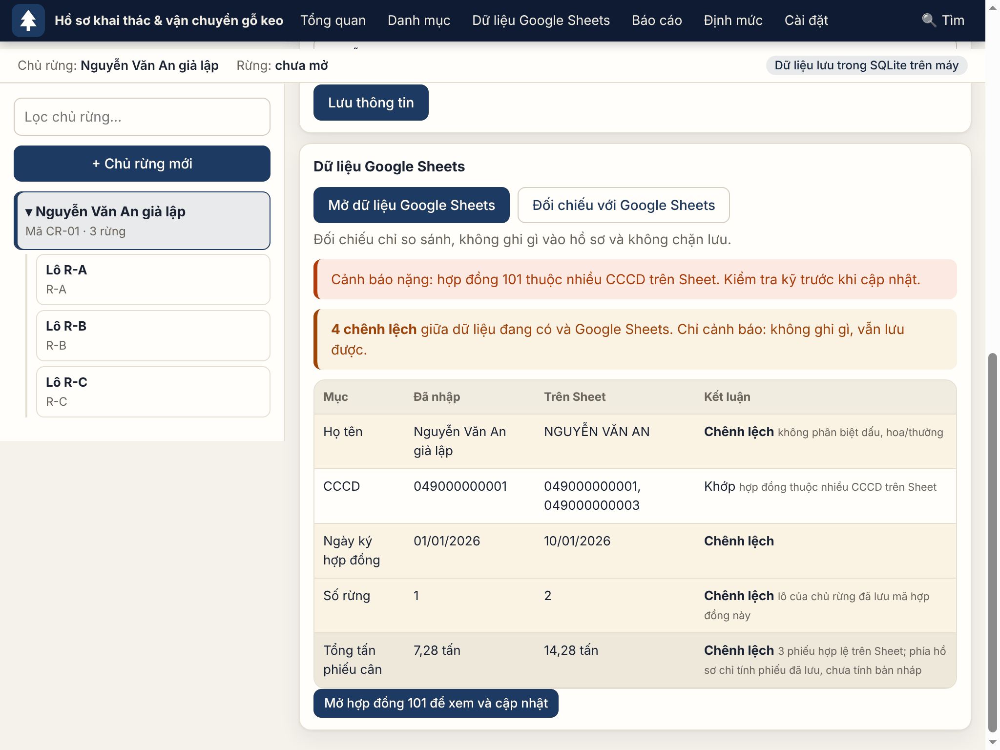 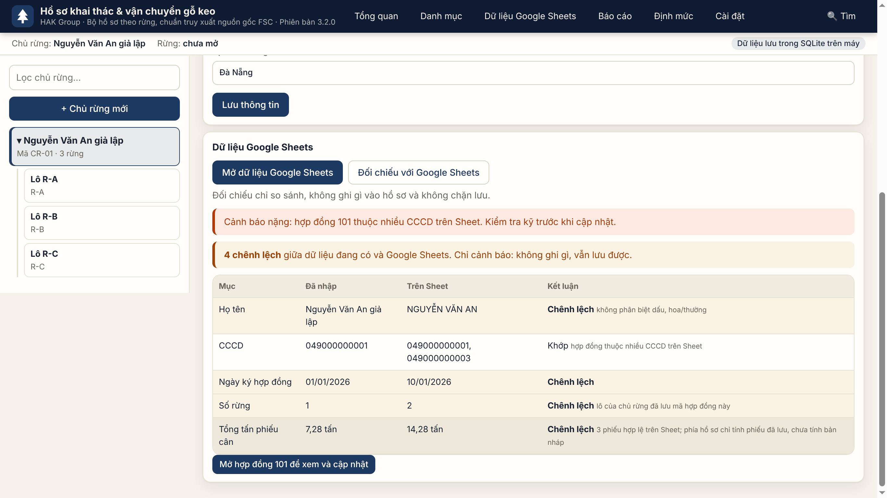
Nhận xét: khung đỏ "Cảnh báo nặng: hợp đồng 101 thuộc nhiều CCCD trên Sheet", khung vàng "4 chênh lệch… Chỉ cảnh báo: không ghi gì, vẫn lưu được"; bảng Mục / Đã nhập / Trên Sheet / Kết luận (Họ tên, CCCD, Ngày ký, Số rừng 1 so 2, Tổng tấn 7,28 so 14,28); nút "Mở hợp đồng 101 để xem và cập nhật". Hiển thị đúng. Lưu ý nội dung: dòng CCCD kết luận "Khớp" dù Sheet có 2 CCCD (đã kèm ghi chú, và có khung cảnh báo nặng phía trên).

Tổng 14 ảnh (7 màn x 2 độ rộng) trong `docs/nghiem-thu-sheets/`.

## 4. Báo cáo toàn vẹn dữ liệu

### 4.1 Lô chưa dùng tính năng mới: băm và delta y nguyên
Đã chạy lại trong phiên này: `node --test tests/luutru-soLog.test.js` = 15 bài, 14 đạt, 0 lỗi, 1 bài còn lại không tính là đạt (không phải lỗi; chưa tra nguyên nhân).
- **LT-02**: dữ liệu cũ (không có `soCu`, `soLog`, `info.nguon`, `taoLuc`) đọc/ghi y nguyên, không tự thêm trường mới, băm dòng không đổi, lưu lại `changed = 0`.
- **LT-02b**: `MIGRATIONS` không dài thêm (trường mới nằm trong JSON của lô, không thêm cột/bảng).
- **LT-03**: thêm rồi bỏ `soLog` đưa lô về đúng chuỗi JSON cũ, diff rỗng: lô chưa dùng tính năng mới không bị coi là đã sửa.
- LT-07/08/09: lô chốt từ bản cũ vẫn nguyên vẹn; thay đổi `soLog`/`soCu`/`info.nguon` sau chốt bị phát hiện, không bị bỏ qua.

### 4.2 Nâng cấp từ v3.2.0 trên BẢN SAO dữ liệu giả lập (đã làm thật)
Cách làm: (1) dùng mã `Store` của v3.2.0 (cây mã `225348d` tại `/tmp/rv`) tạo cơ sở dữ liệu SQLite từ dữ liệu giả lập: 4 chủ rừng, 5 lô, 120 phiếu cân; (2) sao chép tệp; (3) mở bản sao bằng `Store` của mã mới (nhánh này), đọc, so sánh; (4) lưu lại và so tiếp. Kịch bản: `scratchpad/nt/integrity.js` (ngoài kho, không cam kết).

| Chỉ tiêu | Mã v3.2.0 | Mã mới trên bản sao | Kết luận |
|---|---|---|---|
| `user_version` | 15 | 15 | không migration |
| Danh sách bảng | `chot_goi, companies, danh_muc, danh_muc_bang, forests, lookup_rows, lookup_sets, meta, owners, sqlite_sequence` | y hệt | giống |
| Số chủ rừng / lô rừng / phiếu | 4 / 5 / 120 | 4 / 5 / 120 | không đổi |
| SHA-256 bảng `owners` (id, data, hash) | `44670895…1c10805` | `44670895…1c10805` | giống |
| SHA-256 bảng `forests` (id, owner_id, data, hash) | `a9177bc9…553832c` | `a9177bc9…553832c` | giống |
| SHA-256 toàn bộ `load()` | `776256b1…bb564` | `776256b1…bb564` | giống |
| SHA-256 mảng phiếu từng lô f1..f5 | `424a22d0f1df`, `b2e8fb7a9249`, `666701d98c13`, `6da079ecad44`, `492fa09205a0` | y hệt | giống |
| `save(load())` trên bản sao | | `changed = 0`, băm `owners`, `forests` sau đó vẫn như cũ | không ghi lại dòng nào |

**Chưa kiểm** (nói rõ): (a) cơ sở dữ liệu thật của người dùng (không có, chỉ có giả lập); (b) khởi động ứng dụng Electron v3.2.0 rồi mở bằng ứng dụng mới (chỉ dùng lớp `Store`, vì `src/store.js` không đổi nên rủi ro thấp; bộ cài thật do CI Windows kiểm cài mới và nâng cấp từ 1.0.0, 1.4.0, 1.4.33, 2.2.0, 2.3.0, chưa chạy lượt nào cho nhánh này); (c) bảng `lookup_rows/lookup_sets` có dữ liệu Sheet (bản giả lập không nạp Sheet; `src/lookup.js` có đổi: thêm chỉ mục mã hợp đồng, xem mục 5); (d) lô đã chốt có `chot_goi` trong phép so này; phần lô chốt được phủ bởi LT-07/08/09.

## 5. Tồn tại và rủi ro (chưa sửa, cần CHỦ biết)

Chờ CHỦ xác nhận quyết định:
1. **`info.nguon` / QĐ7 chủ rừng / lô ghi thẳng hồ sơ còn phiếu vào bản nháp**: cách ghi nguồn gốc dữ liệu Sheet vào `info.nguon`, ghi chủ rừng (QĐ7) và việc ghi thẳng vào hồ sơ khi lô còn phiếu đang ở bản nháp. Chờ CHỦ xác nhận đúng ý.
2. **QĐ6 Đối chiếu phải bấm nút**, chưa tự động so khi gõ. Chờ CHỦ quyết có muốn tự động hay không.

Giới hạn chức năng đã biết:
3. "Cập nhật vào hồ sơ" **không tự thêm xe**: nếu biển số phiếu chưa có trong danh sách xe của lô, việc **lưu lô bị chặn** (phiếu cân chỉ lưu được khi biển số đã khai). Người dùng phải khai xe trước (e2e phải gài sẵn xe để lưu được).
4. Tọa độ: chỉ chọn **một điểm** làm tâm của rừng.
5. Rừng thiếu mã rừng (Sheet không có ToaDoRung): phải **gõ tay** mã rừng; hiện "chưa có mã rừng" và không tự nhận phiếu.
6. **P3-6**: `aliasKhop` coi thiếu ngày là cùng ngày (có thể ghép nhầm hai phiếu khác ngày nhưng cùng số khi một bên thiếu ngày).
7. `summaryHd` (tính trạng thái bảng hợp đồng) đồng bộ ở tiến trình `main`: tính ở tiến trình chính; hiện gọi theo lô 200 và ưu tiên dòng đang hiện. Chưa đo với Sheet rất lớn.
8. `Lookup.rows`: bỏ `ORDER BY` trong SQL (để dùng chỉ mục, tránh quét cả bản), sắp xếp trong JS. Thứ tự kết quả do JS bảo đảm; cần chú ý nếu sau này có người sửa lại.
9. `window.lkMoHopDong` không công khai; chỉ `window.moDuLieuSheets({maHd})` là điểm vào công khai (màn chủ rừng dùng điểm này).
10. Cửa sổ `minWidth` 1024: ngoài 1024 chỉ dùng được khi cố ý hạ `minimumSize`; khung ≤ 820 px đã xử lý (Cha trên Con) nhưng chỉ kiểm bằng e2e.
11. Hiển thị (mục 3): 1024x768 bảng hợp đồng chỉ thấy ~2 dòng không cuộn; cột "Vào rừng" hẹp xuống dòng nhiều; nút phân trang `‹ ›` lấn mép thẻ và bị chân modal cắt một phần; dòng CCCD "Khớp" khi hợp đồng có nhiều CCCD.
12. **CI Windows chưa chạy**; **chưa kiểm trên Windows thật** và ở **scaling 150 %**; bản cài chưa dựng. Agent không cài thử được trên Windows.
13. Ảnh chụp là Electron trên Linux (Xvfb): phông chữ và dựng chữ có thể khác trên Windows.

## 6. Hướng dẫn kiểm tay cho CHỦ (6 bước, trên BẢN SAO dữ liệu, không dùng dữ liệu thật đang chạy)

Chuẩn bị: sao lưu thư mục dữ liệu (hoặc dùng `HAKQN_DB`/`HAKQN_USERDATA` trỏ tới bản sao). Chuẩn bị Excel giả lập 3 tab (Màn Dữ liệu Google Sheets → "Tải file mẫu (3 tab chuẩn)"; điền vài dòng CCCD `0490000000xx`).

**Bước 1. Cài mới và nâng cấp từ v3.2.0.**
1. Máy sạch: cài bản mới, mở, vào Danh mục/Chủ rừng, tạo 1 chủ rừng, 1 lô, vài phiếu; thoát, mở lại: dữ liệu còn.
2. Máy đang dùng v3.2.0: chép thư mục dữ liệu ra nơi khác; ghi lại **số chủ rừng, số rừng (lô), tổng số phiếu** (xem Tổng quan hoặc Báo cáo). Cài bản mới đè lên, mở: ba con số **không đổi**; tên chủ rừng, CCCD, tổng tấn của vài lô bất kỳ không đổi. Trong thư mục `backups` phải thấy bản sao lưu tên bắt đầu bằng `truoc-` nếu ứng dụng có nâng cấp cấu trúc (bản này không đổi cấu trúc nên có thể không có bản `truoc-nang-cap-…`).

**Bước 2. Hợp đồng 2 rừng.**
1. Menu **Dữ liệu Google Sheets** → **Nhập bản Excel** → chọn Excel giả lập có hợp đồng 2 rừng (như HD-A01: 2 rừng, 6 phiếu).
2. Màn đầu là bảng hợp đồng; gõ tên không dấu vào ô tìm → **Tìm** → bấm dòng hợp đồng.
3. Thẻ **Phiếu cân**: kiểm phân bổ tự động (rừng nhập trước nhận đến hết dự kiến, phần còn lại sang rừng sau). Đổi tay **một** phiếu sang rừng kia ở cột "Vào rừng"; kiểm thanh đã dùng/dự kiến đổi theo. Thử dồn hết vào một rừng: phải hiện khung đỏ "Vượt dự kiến … tấn" nhưng vẫn cho cập nhật.
4. Duyệt từng thẻ **Hồ sơ rừng** và **Tọa độ**; chọn các mục cần ghi (hoặc **Chọn phần mới**) → **Cập nhật vào hồ sơ** → xác nhận. Thông báo phải nói "bản nháp" và nhắc "Lưu dữ liệu vào lô".
5. Mở lô vừa tạo (tab Rừng) → bấm **Lưu dữ liệu vào lô** (cần biển số phiếu đã có trong danh sách xe, xem mục 5.3). Thoát hẳn ứng dụng, mở lại: các phiếu và phân bổ còn nguyên. Mở lại hợp đồng trên Sheet: mọi phiếu hiện "Trùng — bỏ qua"; bấm **Cập nhật vào hồ sơ** lần nữa phải báo không có thay đổi nào.

**Bước 3. Mã hợp đồng nhiều CCCD; Sheet lỗi, rỗng, mất mạng.**
1. Mở hợp đồng có 2 CCCD (như HD-D04, nhãn "Lỗi dữ liệu"): nút **Cập nhật vào hồ sơ** bị khóa. Bấm **Xác nhận cảnh báo (2 bước)**: bước 1/2 nêu CCCD và dòng Sheet → bấm nút đồng ý; bước 2/2 phải tích "Tôi hiểu rủi ro" rồi mới xác nhận được; thử **Hủy** và **Esc** ở mỗi bước: nút Cập nhật vẫn khóa.
2. Nhập Excel thiếu cột/thiếu tab: phải báo lỗi rõ và **dữ liệu tra cứu cũ giữ nguyên**. Nhập file Excel rỗng: tương tự.
3. Ngắt mạng (rút cáp/tắt Wi-Fi) rồi **Đồng bộ ngay**: báo lỗi kết nối rõ ràng, danh sách hợp đồng cũ vẫn xem được, hồ sơ không đổi.

**Bước 4. Nghi đổi số.**
1. Nhập Excel A (phiếu `S-1001` và `S-1002`), cập nhật vào hồ sơ và **Lưu dữ liệu vào lô**. Ghi tổng tấn lô.
2. Nhập Excel B: giống A nhưng `S-1001` đổi thành `S-1001B` (cùng ngày, BKS, khối lượng). Mở hợp đồng, thẻ Phiếu cân: `S-1001B` phải hiện "Nghi đổi số", ô tích khóa. Bấm **Cập nhật vào hồ sơ** khi chưa chọn: **không ghi gì**.
3. Chọn **Đổi số S-1001 → S-1001B (giữ nguyên phiếu)** → Cập nhật → Lưu vào lô. Tổng tấn **không tăng** (không cộng đôi); phiếu mang số mới, số cũ nằm trong lịch sử đổi số.
4. Nhập lại Excel B lần nữa rồi Cập nhật: không thêm phiếu. Nhập lại Excel A cũ: cũng không thêm phiếu. (Có thể thử nhánh **Là chuyến khác (thêm mới)**: thêm đúng 1 phiếu.)

**Bước 5. Thêm chủ rừng nhập tay → Mở/Đối chiếu.**
1. Danh mục/Chủ rừng → **+ Chủ rừng mới**, nhập tay họ tên, CCCD 12 số, **Số hợp đồng** trùng mã trên Sheet, Ngày ký hợp đồng lệch vài ngày so với Sheet → **Lưu thông tin**.
2. Khung **Dữ liệu Google Sheets** bên dưới: bấm **Đối chiếu với Google Sheets**: phải hiện khung vàng "N chênh lệch" và bảng Họ tên / CCCD / Ngày ký / Số rừng / Tổng tấn; **hồ sơ không bị ghi**, nút Lưu vẫn bấm được.
3. Bấm **Mở dữ liệu Google Sheets** (hoặc **Mở hợp đồng … để xem và cập nhật**): mở đúng hợp đồng. Thử nhập số hợp đồng không có trên Sheet: phải báo lỗi, không mở hộp thoại trống. Thử CCCD sai (123): hai nút bị khóa kèm lý do.

**Bước 6. In/xuất hồ sơ trước và sau giống nhau; khôi phục.**
1. Trên bản v3.2.0 (hoặc trước khi nâng cấp), xuất vài hồ sơ của lô có dữ liệu (tab **Xuất hồ sơ**: ví dụ BM-08, BM-14 và bảng kê) ra `.docx`. Sau khi nâng cấp, xuất lại **cùng lô, cùng biểu mẫu**; so hai tệp (số liệu, chữ, định dạng). Máy kiểm thử đã cho 206/206 tài liệu giống từng byte; bước này để CHỦ tự nhìn trên dữ liệu thật của bản sao.
2. Khôi phục: Cài đặt → **Sao lưu và khôi phục** → chọn bản sao lưu `truoc-…` (hoặc bản sao lưu toàn bộ) → xem trước → khôi phục. Kiểm số chủ rừng / rừng / phiếu về đúng con số đã ghi ở Bước 1.

Ghi kết quả từng bước (Đạt/Không đạt, ghi chú, ảnh nếu lỗi) và gửi lại cho Queen.

## 7. Danh sách kiểm phát hành đề xuất

Theo `docs/BAN_GIAO_AGENT_TIEP_THEO.md` mục 6 và 7; **mỗi bước chờ lệnh rõ ràng của CHỦ/CEO**, agent không tự làm.

| # | Việc | Ghi chú |
|---|---|---|
| 0 | CHỦ duyệt hồ sơ này bằng văn bản; quyết hai mục chờ xác nhận ở mục 5 | cổng nghiệm thu |
| 1 | CHỦ kiểm tay 6 bước (mục 6) trên bản sao | ghi kết quả |
| 2 | Chọn số phiên bản: **đề xuất `3.3.0`** (tính năng mới, tương thích dữ liệu, không migration SQLite bắt buộc) | CHỦ quyết |
| 3 | Tăng `package.json` và `package-lock.json` (đang `3.2.0`); thêm mục `## 3.3.0` đầu `CHANGELOG.md`; xem lại `docs/` có nêu số phiên bản (ví dụ tạo `docs/GHI_CHU_PHAT_HANH_3.3.0.md` theo mẫu các bản trước) | nội dung CHANGELOG gợi ý ở dưới |
| 4 | Mở PR từ nhánh làm việc vào `main` (bố cục như PR #84: Đã làm / Kiểm thử / Chưa kiểm; bảng test nêu số thật ở mục 2); `subscribe_pr_activity` | chỉ khi CHỦ cho mở |
| 5 | **CI Windows xanh trên commit cuối** (kèm các bước cài mới và nâng cấp từ 1.0.0, 1.4.0, 1.4.33, 2.2.0, 2.3.0); ghi liên kết lượt chạy vào hồ sơ này | hiện CHƯA có |
| 6 | CHỦ/CEO ra lệnh gộp rõ ràng; gộp kiểu `merge` | không tự gộp |
| 7 | Gắn thẻ `v3.3.0` đúng commit đã gộp (hoặc chạy workflow với `release_tag`). **Đẩy thẻ = phát hành công khai.** Không đụng thẻ cũ `v3.2.0` trở xuống | theo lệnh |
| 8 | Theo dõi workflow tới khi Release tạo xong; kiểm tên tệp `HAKQN-HoSoKhaiThac-Setup-3.3.0.exe`, kích thước, **SHA-256** (ghi vào hồ sơ), `BUILD_INFO.txt` khớp commit, ghi chú Release | |
| 9 | CHỦ cài thử trên một máy sạch và một máy đang dùng v3.2.0 (có 150 % scaling nếu có) | giới hạn: agent không cài được trên Windows |
| 10 | Báo CHỦ: liên kết Release, SHA-256, danh sách kiểm | |

Gợi ý nội dung `CHANGELOG.md` mục 3.3.0: Dữ liệu Google Sheets theo hợp đồng (bảng toàn bộ hợp đồng, hộp thoại Cha–Con theo mã hợp đồng, tìm không dấu); phân bổ phiếu cân vào nhiều rừng (tự động, đổi tay, cảnh báo vượt dự kiến); xác nhận 2 bước khi mã hợp đồng thuộc nhiều CCCD; phát hiện và xử lý nghi đổi số phiếu (nhật ký đổi số ngoài nhật ký chung); Đối chiếu và Mở Google Sheets ở màn chủ rừng; thao tác Đổi số riêng ở phiếu đã lưu. Không đổi cấu trúc cơ sở dữ liệu, không đổi bản in (206/206).

**Phương án lùi:** (1) trước khi nâng cấp, sao lưu thư mục dữ liệu; (2) nếu bản 3.3.0 lỗi: **giữ lại hoặc cài lại bản v3.2.0** (Release v3.2.0 không bị đụng), khôi phục bản sao lưu `truoc-…` hoặc bản sao thư mục dữ liệu đã chép; vì không có migration SQLite (`user_version` vẫn 15) bản 3.2.0 mở được cơ sở dữ liệu do 3.3.0 ghi, nhưng các trường mới (`soCu`, `soLog`, `info.nguon`, `taoLuc`) sẽ bị 3.2.0 bỏ qua, nên nên khôi phục từ bản sao lưu nếu đã dùng tính năng mới (**chưa kiểm** chiều lùi này bằng bản chạy thật); (3) Release hoặc thẻ lỗi: **báo CHỦ**, không tự xóa hay chạy lại.
